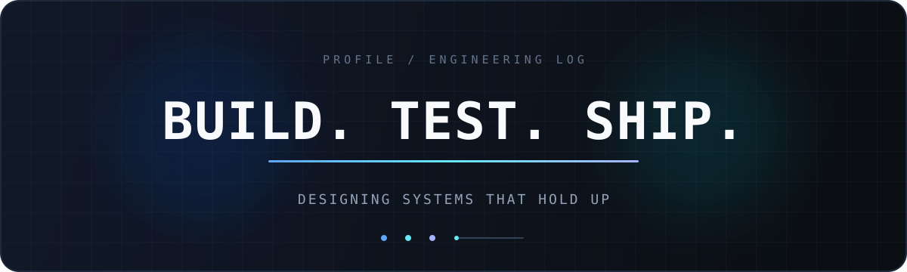
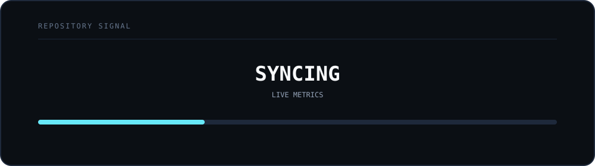

<!-- Generated from README.template.md. Set GITHUB_USERNAME once in .github/profile.env. -->

  
    
  
  
  
  

  

## Stack

  LANGUAGES
    
  
    
  FRAMEWORKS AND DATA
    
  
    
  INFRASTRUCTURE AND TOOLING
    
  

## Metrics

  
    
  <picture>
    <source media="(prefers-color-scheme: dark)" srcset="https://streak-stats.demolab.com?user=Jyotiraditya21-bug&hide_border=true&background=0B0F14&ring=60A5FA&fire=67E8F9&currStreakLabel=67E8F9&sideLabels=94A3B8&dates=64748B&currStreakNum=F8FAFC&sideNums=F8FAFC">
    <source media="(prefers-color-scheme: light)" srcset="https://streak-stats.demolab.com?user=Jyotiraditya21-bug&hide_border=true&background=FFFFFF&ring=2563EB&fire=0891B2&currStreakLabel=0891B2&sideLabels=475569&dates=64748B&currStreakNum=0F172A&sideNums=0F172A">
    
  </picture>

## Activity

  <picture>
    <source media="(prefers-color-scheme: dark)" srcset="https://raw.githubusercontent.com/Jyotiraditya21-bug/Jyotiraditya21-bug/output/github-contribution-grid-snake-dark.svg">
    <source media="(prefers-color-scheme: light)" srcset="https://raw.githubusercontent.com/Jyotiraditya21-bug/Jyotiraditya21-bug/output/github-contribution-grid-snake.svg">
    
  </picture>
    
  <picture>
    <source media="(prefers-color-scheme: dark)" srcset="https://github-readme-activity-graph.vercel.app/graph?username=Jyotiraditya21-bug&bg_color=0B0F14&color=94A3B8&line=67E8F9&point=F8FAFC&area=true&area_color=1E40AF&hide_border=true&hide_title=true">
    <source media="(prefers-color-scheme: light)" srcset="https://github-readme-activity-graph.vercel.app/graph?username=Jyotiraditya21-bug&bg_color=FFFFFF&color=475569&line=0891B2&point=0F172A&area=true&area_color=BFDBFE&hide_border=true&hide_title=true">
    
  </picture>

## Current feed

<table>
  <tr>
    <td width="50%" valign="top">
      <strong>Recently updated</strong>  
      <!-- LATEST_REPOS:START -->
- [`pixelpilot`](https://github.com/Jyotiraditya21-bug/pixelpilot) · Python · ★ 0
- [`pause-stress-mvp`](https://github.com/Jyotiraditya21-bug/pause-stress-mvp) · JavaScript · ★ 0
      <!-- LATEST_REPOS:END -->
    </td>
    <td width="50%" valign="top">
      <strong>Public activity</strong>  
      <!-- RECENT_ACTIVITY:START -->
- Pushed to [`Jyotiraditya21-bug/pixelpilot`](https://github.com/Jyotiraditya21-bug/pixelpilot)
- Starred [`EvolvingLMMs-Lab/lmms-eval`](https://github.com/EvolvingLMMs-Lab/lmms-eval)
- Created a ref in [`Jyotiraditya21-bug/pixelpilot`](https://github.com/Jyotiraditya21-bug/pixelpilot)
- Updated a pull request in [`EvolvingLMMs-Lab/lmms-eval`](https://github.com/EvolvingLMMs-Lab/lmms-eval)
      <!-- RECENT_ACTIVITY:END -->
    </td>
  </tr>
</table>

  
System notes

   
  This profile refreshes its repository feed, public activity and timestamp automatically. Public metrics may occasionally be rate-limited; the source services can be self-hosted if required.

 

  
    
  
    
  UPDATED 24 Nov 2026 · 13:50 UTC

